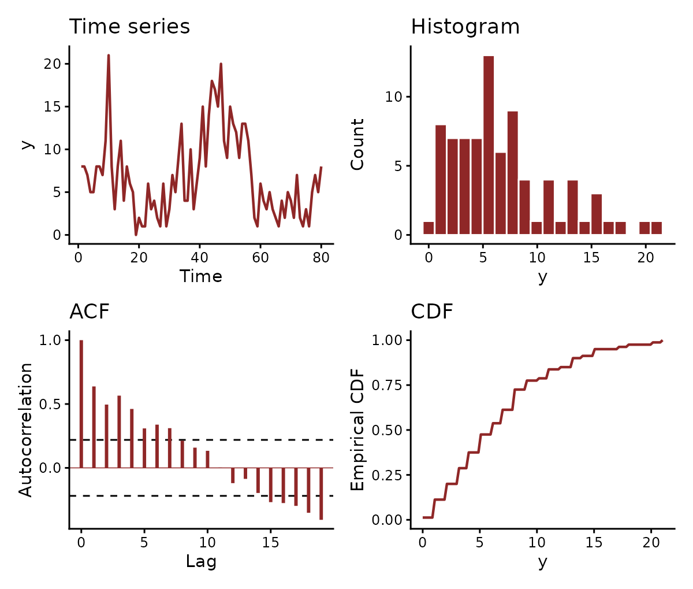

# Formatting data for mvgam

[`mvgam()`](https://nicholasjclark.github.io/mvgam/dev/reference/mvgam.md)
takes data in long format, one row per series and time. Most failed fits
come from a frame that misses that shape: a `series` column stored as
character, gaps in the `time` index, a column the formula names but the
data lack, missing covariate values or a response outside the family’s
support. This vignette sets out each requirement and shows how
[`mvgam_data()`](https://nicholasjclark.github.io/mvgam/dev/reference/mvgam_data.md)
checks a frame against them before any Stan code is compiled.

## The long-format requirement

Each observation takes its own row, indexed by a time column and, for a
model with a latent trend, a series column. The default names are `time`
and `series`. Every trend constructor takes `time` and `series`
arguments naming other columns, as in
`AR(time = epiWeek, series = plotID)`, and
[`jsdgam()`](https://nicholasjclark.github.io/mvgam/dev/reference/jsdgam.md)
takes `unit` and `species`. The `birdsong` data that ship with mvgam use
the defaults, with weekly counts of four species over 80 weeks:

``` r

data(birdsong)
str(birdsong)
#> 'data.frame':    320 obs. of  7 variables:
#>  $ series      : Factor w/ 4 levels "warbler","thrush",..: 1 1 1 1 1 1 1 1 1 1 ...
#>  $ time        : int  1 2 3 4 5 6 7 8 9 10 ...
#>  $ y           : int  8 8 7 5 5 8 8 7 11 21 ...
#>  $ species     : Factor w/ 4 levels "warbler","thrush",..: 1 1 1 1 1 1 1 1 1 1 ...
#>  $ week        : int  1 2 3 4 5 6 7 8 9 10 ...
#>  $ week_in_year: int  1 2 3 4 5 6 7 8 9 10 ...
#>  $ count       : int  8 8 7 5 5 8 8 7 11 21 ...
head(birdsong, 4)
#>    series time y species week week_in_year count
#> 1 warbler    1 8 warbler    1            1     8
#> 2 warbler    2 8 warbler    2            2     8
#> 3 warbler    3 7 warbler    3            3     7
#> 4 warbler    4 5 warbler    4            4     5
```

Each `(series, time)` cell has one row. `series` is a factor and `time`
an integer week. A fit uses the series and time columns, the response
its formula names and any covariates the formulas refer to. The
`species` and `week` columns duplicate `series` and `time`.
`RW(time = week, series = species)` would use them instead.

[`sim_mvgam()`](https://nicholasjclark.github.io/mvgam/dev/reference/sim_mvgam.md)
returns data in the same format:

``` r

set.seed(1)
simdat <- sim_mvgam(n_series = 3L, n_timepoints = 24L,
                     prop_missing = 0.2)
head(simdat$data_train, 6)
#>           y   series time          x
#> 1 1.5818644 series_1    1 -0.9379653
#> 2 1.6736683 series_1    2 -0.5115044
#> 3 1.4503445 series_1    3  0.2914135
#> 4        NA series_1    4  1.6328312
#> 5 3.0462045 series_1    5 -1.1932723
#> 6 0.1742494 series_1    6  1.5935587
```

`prop_missing = 0.2` sets a fifth of the responses to `NA`. A missing
response is allowed:
[`mvgam()`](https://nicholasjclark.github.io/mvgam/dev/reference/mvgam.md)
leaves it out of the likelihood and still estimates the latent state at
that time.

## The `series` factor

A model with a latent trend places every row on one series. Its data
needs a series column: `series` by default, or any column named through
`AR(series = ...)` or `jsdgam(species = ...)`. That column must be a
`factor`. Its levels fix the order of the series in every summary, plot
and forecast. A `character` column looks the same in
[`head()`](https://rdrr.io/r/utils/head.html) and fails the check:

``` r

class(birdsong$series)
#> [1] "factor"
levels(birdsong$series)
#> [1] "warbler" "thrush"  "wren"    "finch"
```

``` r

char_series <- birdsong
char_series$series <- as.character(char_series$series)
mvgam_data(char_series, family = poisson(),
                 trend_formula = ~ AR(), plot = FALSE)
#> Error:
#> ! Column 'series' must be a factor.
#>   Got class 'character'.
#>   A factor's levels fix the order of the series.
#>   Convert it with data$series <- factor(data$series).
```

[`factor()`](https://rdrr.io/r/base/factor.html) converts the column. A
single time series needs the column too, holding one level:

``` r

one <- birdsong[birdsong$series == levels(birdsong$series)[1L], ]
one$series <- factor("series_1")
levels(one$series)
#> [1] "series_1"
```

A model without a trend has no series axis and needs no series column.

[`mvgam()`](https://nicholasjclark.github.io/mvgam/dev/reference/mvgam.md)
drops a level that no row holds.
[`droplevels()`](https://rdrr.io/r/base/droplevels.html) does the same
before fitting:

``` r

extra_level <- birdsong
extra_level$series <- factor(
  extra_level$series,
  levels = c(levels(extra_level$series), "phantom_species")
)
setdiff(levels(extra_level$series), unique(extra_level$series))
#> [1] "phantom_species"
extra_level$series <- droplevels(extra_level$series)
levels(extra_level$series)
#> [1] "warbler" "thrush"  "wren"    "finch"
```

## The `time` variable

The time column must be numeric. A trend that advances the latent state
one time step at a time, such as
[`RW()`](https://nicholasjclark.github.io/mvgam/dev/reference/trend_constructors.md),
[`AR()`](https://nicholasjclark.github.io/mvgam/dev/reference/trend_constructors.md),
[`VAR()`](https://nicholasjclark.github.io/mvgam/dev/reference/trend_constructors.md),
[`LLT()`](https://nicholasjclark.github.io/mvgam/dev/reference/LLT.md)
or
[`PW()`](https://nicholasjclark.github.io/mvgam/dev/reference/piecewise_trends.md),
needs evenly spaced times within each series. The response may still be
missing at any time.

``` r

range(birdsong$time)
#> [1]  1 80
tapply(birdsong$time, birdsong$series, function(t) diff(range(t)) + 1L)
#> warbler  thrush    wren   finch 
#>      80      80      80      80
```

Each species covers the same 80 weeks. Where some `(series, time)` rows
are absent altogether,
[`expand.grid()`](https://rdrr.io/r/base/expand.grid.html) builds the
full grid and a merge restores the rows:

``` r

sparse <- birdsong[!(birdsong$series == "warbler" &
                       birdsong$time %in% c(5L, 6L, 7L)), ]
nrow(sparse)
#> [1] 317
filled <- merge(
  expand.grid(series = levels(sparse$series),
              time   = sort(unique(sparse$time))),
  sparse, by = c("series", "time"), all.x = TRUE
)
nrow(filled)
#> [1] 320
sum(is.na(filled$y))
#> [1] 3
```

The merge gives each restored row an `NA` response.

### Irregular sampling

Where observations are irregular by design,
[`CAR()`](https://nicholasjclark.github.io/mvgam/dev/reference/trend_constructors.md)
fits a continuous-time AR(1) process whose autocorrelation decays with
the time elapsed between observations. Its series may be observed at
their own times, with no rows added for the times a series lacks.
[`ZMVN()`](https://nicholasjclark.github.io/mvgam/dev/reference/ZMVN.md)
has no time dynamics and accepts any spacing. On such a series,
`plot(type = "residuals")` checks the residuals with a semivariogram,
which measures their dependence by the time between observations.
[`?CAR`](https://nicholasjclark.github.io/mvgam/dev/reference/trend_constructors.md)
gives a worked example.

## Converting time series objects

[`series_to_mvgam()`](https://nicholasjclark.github.io/mvgam/dev/reference/series_to_mvgam.md)
builds the long frame from the objects other forecasting packages work
with: a `ts`, `mts` or `msts` from base R and forecast, a `tsibble` from
the tidyverts packages or a wide `data.frame` holding a date column and
one column per series. Each column of an `mts` becomes a series. `h`
holds out the final time steps as test data:

``` r

deaths <- series_to_mvgam(cbind(male = mdeaths, female = fdeaths),
                          h = 12L)
head(deaths$data_train, 4)
#>   series time    y    index season
#> 1   male    1 2134 1974.000      1
#> 2 female    1  901 1974.000      1
#> 3   male    2 1863 1974.083      2
#> 4 female    2  689 1974.083      2
```

The `season` column holds the month, taken from the frequency of the
`ts`, for a cyclic smooth such as `s(season, bs = "cc")`. A `tsibble`
supplies its series from its key and its time grid from its index.
Because a regular `tsibble` is filled to its full grid, the months its
index skips arrive as rows with a missing response. An irregular
`tsibble` keeps its own times for
[`CAR()`](https://nicholasjclark.github.io/mvgam/dev/reference/trend_constructors.md)
or
[`ZMVN()`](https://nicholasjclark.github.io/mvgam/dev/reference/ZMVN.md).
Measured variables other than the response become covariates:

``` r

library(tsibble)
set.seed(2)
visits <- tsibble(
  month  = rep(yearmonth("2023 Jan") + c(0:5, 8:11), 2),
  clinic = rep(c("north", "south"), each = 10),
  visits = rpois(20, 30),
  staff  = rpois(20, 6),
  key = clinic, index = month
)
clinics <- series_to_mvgam(visits, response = "visits")
clinics[clinics$time %in% 6:9, ]
#>    series time visits    month clinic season staff
#> 11  north    6     28 2023 Jun  north      6     8
#> 12  south    6     26 2023 Jun  south      6     5
#> 13  north    7     NA 2023 Jul  north      7    NA
#> 14  south    7     NA 2023 Jul  south      7    NA
#> 15  north    8     NA 2023 Aug  north      8    NA
#> 16  south    8     NA 2023 Aug  south      8    NA
#> 17  north    9     40 2023 Sep  north      9     8
#> 18  south    9     41 2023 Sep  south      9     5
```

Binding future rows from
[`tsibble::new_data()`](https://tsibble.tidyverts.org/reference/new-data.html)
to the observed rows before conversion continues the same `time` grid,
which keeps the forecast frame aligned with the training frame.

`freq` states seasonal periods in time steps, matching
[`frequency()`](https://rdrr.io/r/stats/time.html) for a `ts` and
`seasonal.periods` for an `msts`. A period above 1 adds a column holding
the position of each row within it, named `season` for a single period
and `season_7`, `season_365.25` and so on for several. The same periods
give
[`LLT()`](https://nicholasjclark.github.io/mvgam/dev/reference/LLT.md) a
season whose shape drifts over the years,
`trend_formula = ~ LLT(season = 12)`, where a cyclic smooth of `season`
holds one shape fixed.

## The response and family compatibility

Each family has a support the response must lie in: non-negative
integers for [`poisson()`](https://rdrr.io/r/stats/family.html) and
[`negbinomial()`](https://paulbuerkner.com/brms/reference/brmsfamily.html),
$`(0, 1)`$ for
[`Beta()`](https://paulbuerkner.com/brms/reference/brmsfamily.html),
positive reals for [`Gamma()`](https://rdrr.io/r/stats/family.html) and
[`lognormal()`](https://paulbuerkner.com/brms/reference/brmsfamily.html)
and 0 or 1 for
[`bernoulli()`](https://paulbuerkner.com/brms/reference/brmsfamily.html).
[`mvgam()`](https://nicholasjclark.github.io/mvgam/dev/reference/mvgam.md)
checks the response against the support before compiling:

``` r

bad_family <- data.frame(
  y      = rnorm(20),
  time   = 1:20,
  series = factor("series_1")
)
mvgam(y ~ 1, data = bad_family, family = Beta(),
      chains = 1L, iter = 1100L, warmup = 1000L, silent = 2L)
#> Error:
#> ! 'y' has values outside the support of family 'beta'.
#>   Requires: 0 < 'y' < 1.
#>   Observed range: [-1.959, 2.066]. 19 of 20 values fall outside, the first
#>   at row 1.
#>   Use zero_inflated_beta() for exact zeros or zero_one_inflated_beta() for
#>   zeros and ones.
```

The error names the support, the observed range and the first offending
row.

## Columns the formulas use

A formula names more columns than its covariates. brms builds the model
frame from the variable inside an
[`offset()`](https://rdrr.io/r/stats/offset.html), the grouping factor
of a random effect and the columns of addition terms such as `trials()`,
[`weights()`](https://rdrr.io/r/stats/weights.html) or `cens()`. Each of
them must be in the data. To show the checks, the chunk below adds
survey minutes as an exposure and an observer as a grouping factor to
`birdsong`. It then drops the observer column:

``` r

surveys <- birdsong
surveys$minutes <- rep(c(30, 45, 60, 45), length.out = nrow(surveys))
surveys$observer <- factor(rep(c("a", "b", "c"),
                               length.out = nrow(surveys)))
no_observer <- surveys[, names(surveys) != "observer"]
mvgam_data(no_observer,
           formula = y ~ offset(log(minutes)) + (1 | observer),
           family = poisson(), plot = FALSE)
#> Error:
#> ! Columns the model uses are missing from 'data'.
#>   Absent: 'observer'.
```

[`mvgam()`](https://nicholasjclark.github.io/mvgam/dev/reference/mvgam.md)
and
[`stancode()`](https://paulbuerkner.com/brms/reference/stancode.html)
refuse the same frame before brms builds a model. A name held in
`data2`, such as a matrix covariate, counts as present when `data2` is
passed to
[`mvgam_data()`](https://nicholasjclark.github.io/mvgam/dev/reference/mvgam_data.md).

A binomial response counts successes out of the number of trials that
`trials()` names. A count above its trials lies outside the family’s
support. Here each week records how many of 12 listening points detected
the species. One row claims 14:

``` r

set.seed(2)
surveys$points <- 12L
surveys$detected <- rbinom(nrow(surveys), size = 12L, prob = 0.3)
surveys$detected[10L] <- 14L
mvgam_data(surveys, formula = detected | trials(points) ~ 1,
           family = binomial(), plot = FALSE)
#> Error:
#> ! 'detected' has counts above its 'trials()' denominator.
#>   1 of 320 values exceed it, the first at row 10 (detected = 14, trials =
#>   12).
```

## Grouped trends

A hierarchical trend shares its dynamics among the series of a group.
The constructor’s `gr` argument names the column holding each series’
group. Its `subgr` argument names the column holding the series within
that group. The two columns together identify each series, which leaves
the data no need of a `series` column. Here the four `birdsong` species
are split into two habitats:

``` r

grouped <- birdsong[, names(birdsong) != "series"]
grouped$habitat <- factor(
  ifelse(grouped$species %in% c("warbler", "thrush"),
         "forest", "wetland")
)
mvgam_data(grouped, family = poisson(),
           trend_formula = ~ AR(gr = habitat, subgr = species),
           plot = FALSE)
#> ✔ Data check passed for family 'poisson (link = log)'.
#> • series: 4 levels
#> • time:   1 to 80
#> • n obs:  320 (0 NA)
```

Every group must hold the same number of series. Each series must stay
in one group. The check refuses an unbalanced design:

``` r

uneven <- grouped
uneven$habitat[uneven$species == "wren"] <- "forest"
mvgam_data(uneven, family = poisson(),
           trend_formula = ~ AR(gr = habitat, subgr = species),
           plot = FALSE)
#> Error:
#> ! Hierarchical trend models require the same number of series in every
#>   group.
#>   Grouping variable 'habitat' has unbalanced groups: forest=3, wetland=1.
#>   Subset the data to a balanced design or combine small groups.
```

## `mvgam_data()`: pre-flight validation

[`mvgam_data()`](https://nicholasjclark.github.io/mvgam/dev/reference/mvgam_data.md)
runs the checks
[`mvgam()`](https://nicholasjclark.github.io/mvgam/dev/reference/mvgam.md)
runs at fit time: the columns the formulas and the trend constructor
name, the series factor, even spacing for a trend that needs it, the
response support and missing values in the model’s columns. With
`plot = TRUE` it also draws the series, its histogram, its
autocorrelation and its empirical distribution:

``` r

mvgam_data(
  data    = birdsong,
  family  = poisson(),
  series  = 1L
)
#> ✔ Data check passed for family 'poisson (link = log)'.
#> • series: 4 levels
#> • time:   1 to 80
#> • n obs:  320 (0 NA)
```



The check reports the family, the number of series, the time range and
the number of rows. `series = 1L` draws the first species.
`series = "all"` draws every species in one faceted plot. The call
returns an `mvgam_data` object invisibly.

Data that fail a check raise an error. Three common cases:

``` r

bad_y <- birdsong
bad_y$y <- bad_y$y - 0.5  # introduce negative non-integers
mvgam_data(bad_y, family = poisson(), plot = FALSE)
#> Error:
#> ! 'y' has values outside the support of family 'poisson'.
#>   Requires: 0 <= 'y' (integers only).
#>   Observed range: [-0.5, 27.5]. 18 of 320 values fall outside, the first
#>   at row 19.
#>   Check the column for missing-data sentinels such as -1 or -999.
```

Subtracting 0.5 left the counts fractional and some negative.
[`?brmsfamily`](https://paulbuerkner.com/brms/reference/brmsfamily.html)
gives the support of each brms family. Each family mvgam adds gives its
support on its own help page:
[`?tweedie`](https://nicholasjclark.github.io/mvgam/dev/reference/tweedie.md),
[`?beta_nb`](https://nicholasjclark.github.io/mvgam/dev/reference/beta_nb.md),
[`?com_binomial`](https://nicholasjclark.github.io/mvgam/dev/reference/com_binomial.md),
[`?nmix`](https://nicholasjclark.github.io/mvgam/dev/reference/nmix.md)
or
[`?occ`](https://nicholasjclark.github.io/mvgam/dev/reference/occ.md).

``` r

gap <- birdsong[birdsong$time != 5L, ]
mvgam_data(gap, family = poisson(), trend_formula = ~ AR(),
                  plot = FALSE)
#> Error:
#> ! The trend needs regularly spaced times in 'time'.
#>   Gaps between times range from 1 to 2.
#>   Add the missing times as rows with an NA response.
#>   'CAR()' models a trend over irregular times.
```

`trend_formula = ~ AR()` turns on the spacing check, which finds the
removed week. Without a `trend_formula`,
[`mvgam_data()`](https://nicholasjclark.github.io/mvgam/dev/reference/mvgam_data.md)
checks the data for a model with no trend, which needs neither even
spacing nor a series column.

A missing response is allowed, but a missing covariate value is not:
every row needs its covariates, including a row whose response is
missing.
[`mvgam_data()`](https://nicholasjclark.github.io/mvgam/dev/reference/mvgam_data.md)
checks the columns that the `formula` and `trend_formula` it is given
refer to:

``` r

miss_cov <- birdsong
miss_cov$temp <- rnorm(nrow(miss_cov))
miss_cov$temp[5L] <- NA
mvgam_data(miss_cov, formula = y ~ temp,
                  family = poisson(), plot = FALSE)
#> Error:
#> ! Columns the model uses hold missing values in 'data'.
#>   'temp': 1 NA, first at row 5.
#>   Impute the missing values before fitting.
```

[`mvgam()`](https://nicholasjclark.github.io/mvgam/dev/reference/mvgam.md)
runs the same check before compiling. Without a `formula`,
[`mvgam_data()`](https://nicholasjclark.github.io/mvgam/dev/reference/mvgam_data.md)
cannot tell which columns the model uses. It then leaves `temp`
unchecked.

## Newdata for forecasts: `check_newdata()`

[`forecast()`](https://generics.r-lib.org/reference/forecast.html) and
[`predict()`](https://rdrr.io/r/stats/predict.html) take a `newdata`
frame holding the future times and every covariate the model uses.
`check_newdata(newdata, data, trend_formula)` compares its time and
series columns with the training data before any prediction runs. Like
[`mvgam()`](https://nicholasjclark.github.io/mvgam/dev/reference/mvgam.md),
it takes the column names from the trend constructor. It also coerces
the series column to the training levels:

``` r

future_df <- data.frame(
  series = factor(rep(levels(birdsong$series), each = 4L)),
  time   = rep(81L:84L, times = 4L)
)
str(check_newdata(future_df, birdsong, trend_formula = ~ AR()))
#> 'data.frame':    16 obs. of  2 variables:
#>  $ series: Factor w/ 4 levels "warbler","thrush",..: 1 1 1 1 2 2 2 2 3 3 ...
#>  $ time  : int  81 82 83 84 81 82 83 84 81 82 ...
```

A series the model never saw has no fitted trend to forecast from. The
check refuses it:

``` r

bad_future <- data.frame(
  series = factor("phantom_species"),
  time   = 81L
)
check_newdata(bad_future, birdsong, trend_formula = ~ AR())
#> Error:
#> ! Series in 'newdata' has levels absent from the training data.
#>   Unseen: "phantom_species".
#>   Fitted levels: "warbler", "thrush",
#>   "wren", and "finch".
```

`mvgam(newdata = )` runs the same check on held-out data. It also
refuses a frame missing a column the formulas use.

## Closure-unit data shape

Closure-unit families add a `visit` column to the long format above.
They are
[`occ()`](https://nicholasjclark.github.io/mvgam/dev/reference/occ.md)
and the variants of
[`nmix()`](https://nicholasjclark.github.io/mvgam/dev/reference/nmix.md).
Each row records one visit to a sampling unit. The
[`sim_closure_unit_data()`](https://nicholasjclark.github.io/mvgam/dev/reference/sim_closure_unit_data.md)
helper builds this layout:

``` r

occ_dat <- sim_closure_unit_data(
  family    = occ(),
  type      = 1L,
  n_species = 2L,
  n_sites   = 12L,
  n_visits  = 3L,
  seed      = 1L
)
head(occ_dat$data_train, 6)
#>   visit site series time y cap        env     tod_c
#> 1     1    1   sp_1    1 0   1 -0.6264538 -2.793352
#> 2     2    1   sp_1    1 1   1 -0.6264538  3.530878
#> 3     3    1   sp_1    1 1   1 -0.6264538  2.787765
#> 4     1    2   sp_1    2 0   1  0.1836433 -1.366631
#> 5     2    2   sp_1    2 1   1  0.1836433 -4.704676
#> 6     3    2   sp_1    2 0   1  0.1836433  2.312779
```

`series` holds the species and `time` the closure unit, which is the
site here and the season when `multi_season = TRUE`. `visit` numbers the
repeat visits within a unit and `y` records the detection. The
covariates of the state and detection formulas, `bf(y ~ ..., p ~ ...)`,
are further columns.
[`mvgam_data()`](https://nicholasjclark.github.io/mvgam/dev/reference/mvgam_data.md)
checks this layout when given
[`occ()`](https://nicholasjclark.github.io/mvgam/dev/reference/occ.md)
or
[`nmix()`](https://nicholasjclark.github.io/mvgam/dev/reference/nmix.md):

``` r

mvgam_data(occ_dat$data_train, family = occ(),
           formula = bf(y ~ env, p ~ tod_c), plot = FALSE)
#> ✔ Data check passed for family 'occ (link = logit)'.
#> • series: 2 levels
#> • time:   1 to 12
#> • n obs:  72 (0 NA)
```

[`nmix()`](https://nicholasjclark.github.io/mvgam/dev/reference/nmix.md)
models counts. Its `cap` column sets the upper bound on the latent
abundance of each unit. The bound must be constant within a unit and at
least as large as every count observed there:

``` r

nmix_dat <- sim_closure_unit_data(
  family = nmix(), n_species = 2L, n_sites = 12L, n_visits = 3L,
  seed = 1L
)$data_train
nmix_dat$cap <- 2L
mvgam_data(nmix_dat, family = nmix(),
           formula = bf(y ~ env, p ~ tod_c), plot = FALSE)
#> Error:
#> ! Some 'cap' values are below the observed counts.
#>   Row 12: cap = 2, y = 3.
```

The [N-mixture
article](https://nicholasjclark.github.io/mvgam/articles/nmix.html) fits
a model to data in this layout.

## Joint species distribution models

[`jsdgam()`](https://nicholasjclark.github.io/mvgam/dev/reference/jsdgam.md)
takes the same long format, with one row per sampling unit and species.
Its `unit` argument names the column of units. Its `species` argument
names the column of species, a factor. The units carry no time order.
[`jsdgam()`](https://nicholasjclark.github.io/mvgam/dev/reference/jsdgam.md)
fits a
[`ZMVN()`](https://nicholasjclark.github.io/mvgam/dev/reference/ZMVN.md)
factor model over them. Given that trend,
[`mvgam_data()`](https://nicholasjclark.github.io/mvgam/dev/reference/mvgam_data.md)
runs the checks
[`jsdgam()`](https://nicholasjclark.github.io/mvgam/dev/reference/jsdgam.md)
runs:

``` r

set.seed(3)
jsdm_dat <- expand.grid(
  site = 1:20,
  species = factor(c("sp_a", "sp_b", "sp_c"))
)
jsdm_dat$elev <- rnorm(20)[jsdm_dat$site]
jsdm_dat$present <- rbinom(nrow(jsdm_dat), size = 1L, prob = 0.4)
mvgam_data(jsdm_dat, y = "present", formula = present ~ elev,
           family = bernoulli(),
           trend_formula = ~ ZMVN(time = site, series = species),
           plot = FALSE)
#> ✔ Data check passed for family 'bernoulli (link = logit)'.
#> • series: 3 levels
#> • time:   1 to 20
#> • n obs:  60 (0 NA)
```

## Custom column names

The `time` and `series` arguments of a trend constructor name other
columns. A fit to `birdsong` can use `week` and `species` directly:

``` r

mvgam(
  y ~ s(week_in_year, bs = "cc", k = 10),
  trend_formula = ~ AR(time = week, series = species),
  data    = birdsong,
  family  = poisson(),
  chains  = 2L, silent = 2L
)
```

Every trend constructor takes these arguments.

## A pre-fit checklist

Before calling
[`mvgam()`](https://nicholasjclark.github.io/mvgam/dev/reference/mvgam.md),
check that:

1.  The series column is a factor. A hierarchical trend takes its series
    from the `gr` and `subgr` columns instead.
2.  The time column is numeric. It is evenly spaced within each series
    for a trend that steps one time at a time
    ([`RW()`](https://nicholasjclark.github.io/mvgam/dev/reference/trend_constructors.md),
    [`AR()`](https://nicholasjclark.github.io/mvgam/dev/reference/trend_constructors.md),
    [`VAR()`](https://nicholasjclark.github.io/mvgam/dev/reference/trend_constructors.md),
    [`LLT()`](https://nicholasjclark.github.io/mvgam/dev/reference/LLT.md),
    [`PW()`](https://nicholasjclark.github.io/mvgam/dev/reference/piecewise_trends.md)).
3.  Every column the formulas use is in the data: covariates, offsets,
    random-effect grouping factors and addition terms.
4.  No such column has missing values.
5.  The response lies in the family’s support.

`mvgam_data(data, family = ..., formula = ..., trend_formula = ...)`
checks all five.

## Where to next

- [`?mvgam_data`](https://nicholasjclark.github.io/mvgam/dev/reference/mvgam_data.md)
  for the inspector’s full argument list.
- [`?check_newdata`](https://nicholasjclark.github.io/mvgam/dev/reference/check_newdata.md)
  for the check on forecast frames.
- [`?series_to_mvgam`](https://nicholasjclark.github.io/mvgam/dev/reference/series_to_mvgam.md)
  for the conversion of a `ts`, a `tsibble` or a wide frame.
- [`?brmsfamily`](https://paulbuerkner.com/brms/reference/brmsfamily.html)
  for the brms family library, plus the help page of each family mvgam
  adds
  ([`?tweedie`](https://nicholasjclark.github.io/mvgam/dev/reference/tweedie.md),
  [`?beta_nb`](https://nicholasjclark.github.io/mvgam/dev/reference/beta_nb.md),
  [`?com_binomial`](https://nicholasjclark.github.io/mvgam/dev/reference/com_binomial.md),
  [`?nmix`](https://nicholasjclark.github.io/mvgam/dev/reference/nmix.md),
  [`?occ`](https://nicholasjclark.github.io/mvgam/dev/reference/occ.md))
  for its response-shape rules.
- [`?CAR`](https://nicholasjclark.github.io/mvgam/dev/reference/trend_constructors.md)
  for irregularly spaced times.
- The [overview
  vignette](https://nicholasjclark.github.io/mvgam/articles/mvgam_overview.html)
  for the model surface that consumes the data validated here.
- The [N-mixture
  article](https://nicholasjclark.github.io/mvgam/articles/nmix.html)
  for the closure-unit grain in worked detail.
- The [dynamic factor
  vignette](https://nicholasjclark.github.io/mvgam/articles/dfm.html)
  for the `trend_map` structures that decide which series share a latent
  path once the data are in shape.
