# Overview of the mvgam package

`mvgam` fits Bayesian state-space models to time series, extending the
dynamic generalised additive models of Clark and Wells (2023). The
observation model is a `brms` formula (Bürkner 2017). A second formula,
`trend_formula`, adds a latent state that evolves through time. Temporal
structure that the covariates do not explain is estimated as part of the
latent state. Forecasts carry that structure forward. Stan fits the
model. The fitted object works with the post-processing tools of four
packages: `brms`, `marginaleffects`, `loo`, `bayesplot`.

For an observation $`y_{i,t}`$ on series $`i`$ at time $`t`$, with link
function $`g`$ and a response distribution $`\mathcal{F}`$:

``` math
\begin{align*}
y_{i,t} & \sim \mathcal{F}(\mu_{i,t}, \theta) \\
g(\mu_{i,t}) & = \alpha_i + \textstyle\sum_j f_j(x_{j,i,t})
  + Z_{i,\cdot} \, \eta_{\cdot,t} \\
\eta_{\cdot,t} & \sim \text{trend process}(\eta_{\cdot,t-1}, \dots)
\end{align*}
```

The $`f_j`$ are any terms a `brms` formula accepts: linear effects,
smooths (Wood 2017), Gaussian processes, monotonic effects and random
effects. The latent state $`\eta`$ follows one of the trend processes
below. The loadings $`Z`$ map it onto the series. Each series has its
own state when $`Z`$ is the identity. A few shared factors drive many
series when $`Z`$ has fewer columns than there are series.

## What mvgam can model

Every `brms` family works as the observation model. `mvgam` adds
families for ecological and count data:

| Family | Use case |
|:---|:---|
| [`tweedie()`](https://nicholasjclark.github.io/mvgam/dev/reference/tweedie.md) | Non-negative data with many exact zeros |
| [`beta_nb()`](https://nicholasjclark.github.io/mvgam/dev/reference/beta_nb.md) | Counts with heavier tails than a negative binomial |
| [`com_binomial()`](https://nicholasjclark.github.io/mvgam/dev/reference/com_binomial.md) | Bounded counts that are over- or under-dispersed |
| [`occ()`](https://nicholasjclark.github.io/mvgam/dev/reference/occ.md) | Occupancy from repeated detection surveys |
| [`nmix()`](https://nicholasjclark.github.io/mvgam/dev/reference/nmix.md) | Abundance from repeated counts with imperfect detection |
| [`diri()`](https://nicholasjclark.github.io/mvgam/dev/reference/diri.md), [`multi()`](https://nicholasjclark.github.io/mvgam/dev/reference/multi.md), [`categ()`](https://nicholasjclark.github.io/mvgam/dev/reference/categ.md) | Compositions and categorical outcomes |
| [`mvn()`](https://nicholasjclark.github.io/mvgam/dev/reference/mvn.md), [`mvt()`](https://nicholasjclark.github.io/mvgam/dev/reference/mvt.md) | Correlated continuous responses |

[`?mvgam_families`](https://nicholasjclark.github.io/mvgam/dev/reference/mvgam_families.md)
lists every family by the response type it suits.

`trend_formula` names the latent state with one constructor. It can also
hold covariates and smooths that act on the state:

| Constructor | Latent state | Typical use |
|:---|:---|:---|
| [`RW()`](https://nicholasjclark.github.io/mvgam/dev/reference/trend_constructors.md) | Random walk | Series with no fixed mean |
| `LLT(damped = , season = )` | Level with a time-varying slope and an optional season | Growth that changes rate or levels off, and seasonal shapes that drift |
| `AR(p = )` | Autoregression, including sparse lags such as `p = c(1, 12)` | Momentum and seasonal recurrence |
| `VAR(p = )` | Vector autoregression | Series that drive one another |
| [`CAR()`](https://nicholasjclark.github.io/mvgam/dev/reference/trend_constructors.md) | Continuous-time AR(1) | Irregular times, and series observed at their own times |
| [`ZMVN()`](https://nicholasjclark.github.io/mvgam/dev/reference/ZMVN.md) | Correlated residuals with no time recursion | Sites, regions or species |
| [`PW()`](https://nicholasjclark.github.io/mvgam/dev/reference/piecewise_trends.md) | Piecewise linear or logistic growth | Trends with changepoints |

The constructors share a set of options. `cor = TRUE` correlates the
innovations across series. `gr` with `subgr` pools correlation matrices
across groups. `n_lv` sets a number of shared latent factors below the
number of series. `df` gives the innovations Student-t tails.
`ma = TRUE` adds a moving-average term to
[`RW()`](https://nicholasjclark.github.io/mvgam/dev/reference/trend_constructors.md),
[`AR()`](https://nicholasjclark.github.io/mvgam/dev/reference/trend_constructors.md)
or
[`VAR()`](https://nicholasjclark.github.io/mvgam/dev/reference/trend_constructors.md).
[`?trend_constructors`](https://nicholasjclark.github.io/mvgam/dev/reference/trend_constructors.md)
lists the options each constructor takes.
[`hindcast()`](https://nicholasjclark.github.io/mvgam/dev/reference/hindcast.md)
and [`forecast()`](https://generics.r-lib.org/reference/forecast.html)
return the parts of a state through `component`, such as the level,
slope and season of
[`LLT()`](https://nicholasjclark.github.io/mvgam/dev/reference/LLT.md).

[`mvgam()`](https://nicholasjclark.github.io/mvgam/dev/reference/mvgam.md)
fits data in long format, one row per series and time.
[`jsdgam()`](https://nicholasjclark.github.io/mvgam/dev/reference/jsdgam.md)
fits joint species distribution models to one row per site and species,
with phylogenetic and trait-informed loadings.

## Portal rodent captures

`portal_data` holds monthly captures of four desert rodent species from
the Portal Project, a long-term field study in Arizona (Ernest et
al. 2018). Trapping follows the lunar cycle. Some months went unsampled,
which leaves missing counts. Two covariates come with the counts:
minimum temperature (`mintemp`) and a 12-month moving average of
vegetation greenness (`ndvi_ma12`). We held out the last 12 months of
each series to score forecasts.

``` r

data(portal_data)
train <- subset(portal_data, time <= 68)
test  <- subset(portal_data, time >  68)
```

Fitting any model below needs a working Stan installation, through
either `cmdstanr` or `rstan`; the [cmdstanr
guide](https://mc-stan.org/cmdstanr/articles/cmdstanr.html) covers the
setup.

### One species

The Desert Pocket Mouse (PP) is dormant through the colder months. Its
captures run from long stretches of zeros to peaks above 20.
[`mvgam_data()`](https://nicholasjclark.github.io/mvgam/dev/reference/mvgam_data.md)
checks the counts against the family and plots the series, its
distribution and its autocorrelation, with the held-out months in black:

``` r

pp_train <- droplevels(subset(train, series == "PP"))
pp_test  <- droplevels(subset(test, series == "PP"))
mvgam_data(pp_train, family = poisson(), y = "captures",
           newdata = pp_test)
```

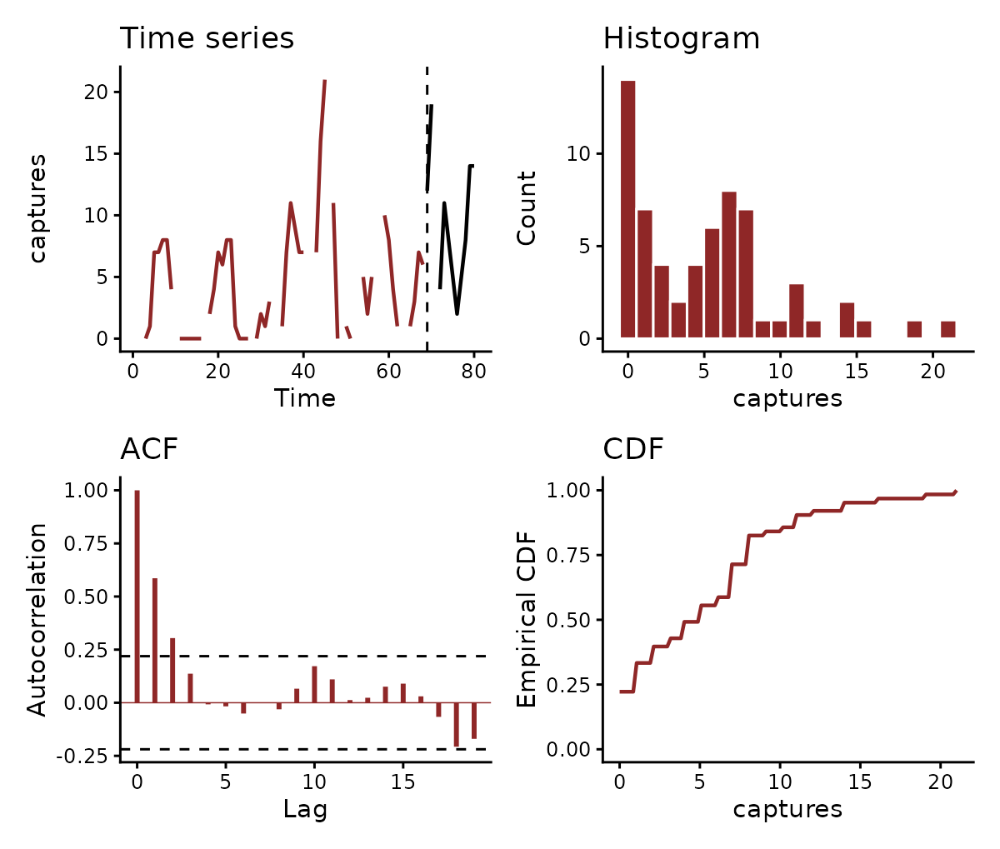

The first model relates captures to smooth functions of the two
covariates, with no latent state:

``` r

fit_gam <- mvgam(
  captures ~ s(mintemp, k = 6) + s(ndvi_ma12, k = 6),
  family  = poisson(),
  data    = pp_train,
  newdata = pp_test,
  silent  = 2
)
```

Captures in one month carry over into the next beyond anything the
covariates explain. The randomised quantile residuals of this model
remain strongly autocorrelated at lag 1:

``` r

plot(fit_gam, type = "residuals", series = "PP")
```

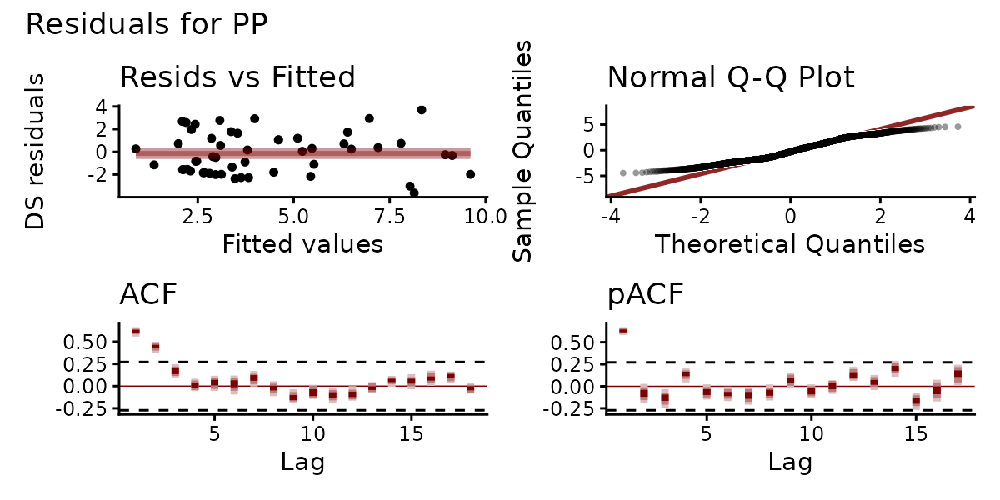

The second model moves both smooths into `trend_formula`, where they act
on a latent state that follows an AR(1) process. The observation formula
keeps the intercept:

``` r

fit_ar <- mvgam(
  captures ~ 1,
  trend_formula = ~ s(mintemp, k = 6) + s(ndvi_ma12, k = 6) + AR(),
  family        = poisson(),
  data          = pp_train,
  newdata       = pp_test,
  silent        = 2
)
```

``` r

summary(fit_ar)
#>  Family: poisson 
#>   Links: mu = log 
#> Formula: captures ~ 1 
#>    Data: pp_train (Number of observations: 68) 
#>  Trends: AR(1); formula: ~s(mintemp, k = 6) + s(ndvi_ma12, k = 6) 
#>   Draws: 4 chains, each with iter = 2000; warmup = 1000; thin = 1; 
#>          total post-warmup draws = 4000
#> 
#> == Observation Model ==
#> Regression Coefficients:
#>           Estimate Est.Error l-95% CI u-95% CI Rhat Bulk_ESS Tail_ESS
#> Intercept     0.83      0.65    -0.54     2.09 1.00     1294     1215
#> 
#> == Trend Model ==
#> Smoothing Spline Hyperparameters:
#>                   Estimate Est.Error l-95% CI u-95% CI Rhat Bulk_ESS Tail_ESS
#> sds(smintemp_1)       1.09      0.97     0.04     3.55 1.00     1753     1899
#> sds(sndvi_ma12_1)     2.45      1.64     0.16     6.34 1.00     1648     1969
#> 
#> Regression Coefficients:
#>              Estimate Est.Error l-95% CI u-95% CI Rhat Bulk_ESS Tail_ESS
#> smintemp_1       3.47      2.24    -0.91     8.29 1.00     1955     2110
#> sndvi_ma12_1     2.92      4.12    -4.62    11.89 1.00     1753     1267
#> 
#> Trend Specific Parameters:
#>                 Estimate Est.Error l-95% CI u-95% CI Rhat Bulk_ESS Tail_ESS
#> sigma_trend[PP]     0.70      0.15     0.45     1.02 1.00     1420     2277
#> ar1_trend[PP]       0.81      0.10     0.60     0.96 1.00     1139     1271
#> 
#> Draws were sampled using sampling(NUTS). For each parameter, Bulk_ESS
#> and Tail_ESS are effective sample size measures, and Rhat is the potential
#> scale reduction factor on split chains (at convergence, Rhat = 1).
#> 
#> Next steps:
#>   - `pp_check(fit)`: posterior predictive checks
#>   - `forecast(fit, newdata = ...)`: out-of-sample forecasts
#>   - `lfo_cv(fit)`: leave-future-out model comparison
#>   - `conditional_effects(fit)`: covariate effects
#> Use `how_to_cite(fit)` for a methods paragraph and `methods_md(fit)` for its equations.
```

The latent state absorbs the persistence from one month to the next. The
residuals of this fit show no autocorrelation left:

``` r

plot(fit_ar, type = "residuals", series = "PP")
```

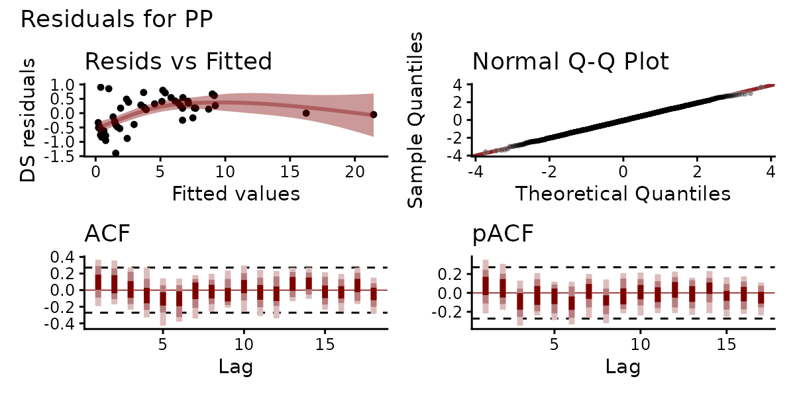

[`pp_check()`](https://nicholasjclark.github.io/mvgam/dev/reference/pp_check.mvgam.md)
compares the observed counts with counts drawn from the fitted model.
The rootogram shows the model reproducing the distribution of captures,
zeros included:

``` r

pp_check(fit_ar, type = "rootogram")
```

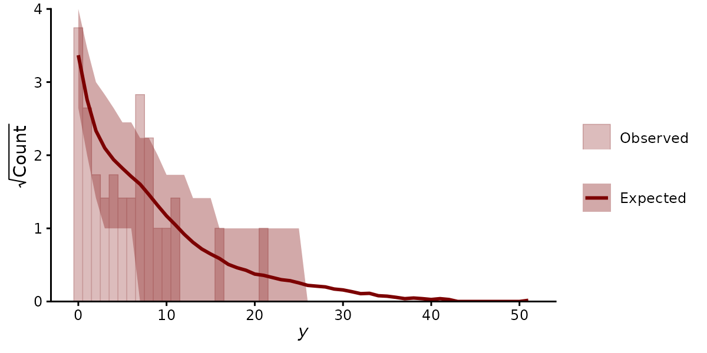

[`conditional_effects()`](https://paulbuerkner.com/brms/reference/conditional_effects.brmsfit.html)
plots each covariate’s effect on the expected count. The
`marginaleffects` functions, such as
[`predictions()`](https://rdrr.io/pkg/marginaleffects/man/predictions.html),
[`comparisons()`](https://rdrr.io/pkg/marginaleffects/man/comparisons.html)
or [`slopes()`](https://rdrr.io/pkg/marginaleffects/man/slopes.html),
work on the fit directly:

``` r

plot(conditional_effects(fit_ar, type = "expected"), ask = FALSE)
```

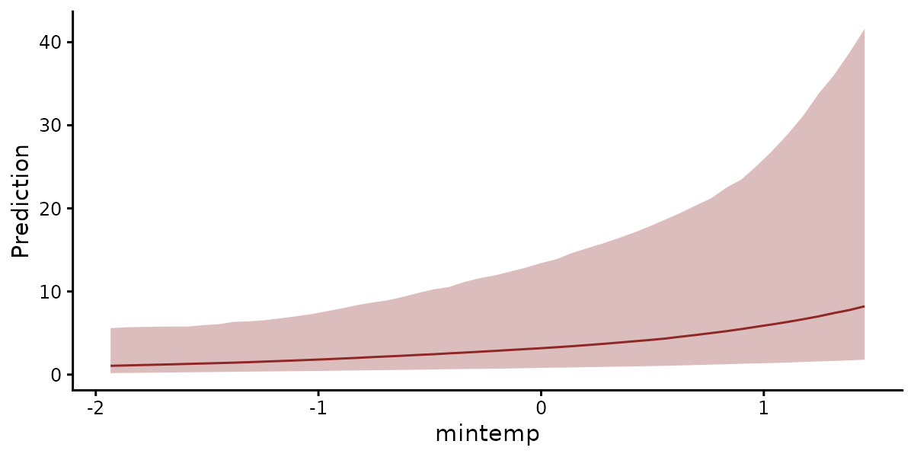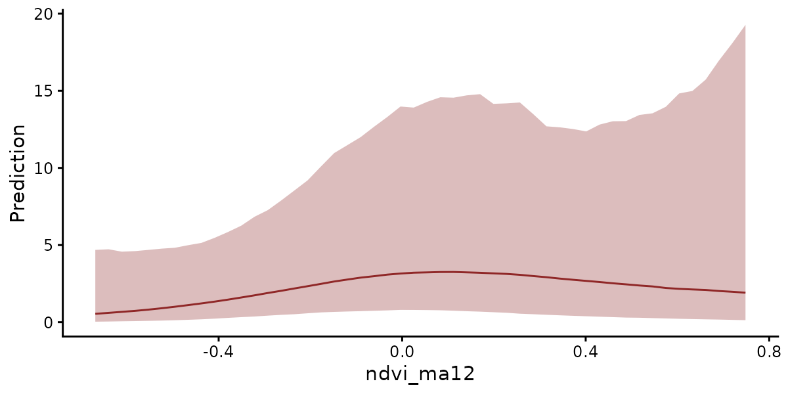

[`forecast()`](https://generics.r-lib.org/reference/forecast.html)
continues the latent state from its last estimated values into the
held-out months. Without a latent state, the first model forecasts from
the covariates alone. Its intervals miss most of the high counts:

``` r

fc_gam <- forecast(fit_gam)
fc_ar  <- forecast(fit_ar)
plot(fc_gam)
```

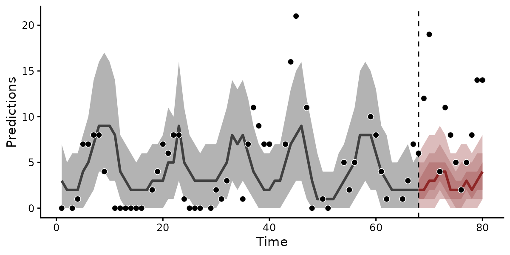

``` r

plot(fc_ar)
```

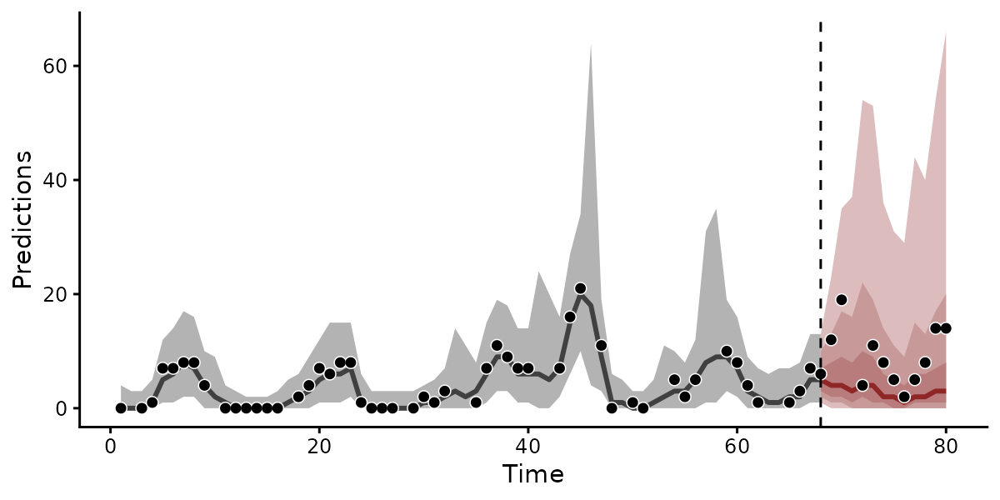

[`compare_scores()`](https://nicholasjclark.github.io/mvgam/dev/reference/compare_scores.md)
scores both forecasts with the continuous ranked probability score
(CRPS), where lower is better.
[`summary()`](https://rdrr.io/r/base/summary.html) sets the scores out
by forecast horizon:

``` r

scores <- compare_scores(fc_gam, fc_ar, score = "crps",
                         model_names = c("GAM", "AR"))
summary(scores)
#> # A tibble: 12 × 4
#>    series eval_horizon    GAM     AR
#>    <fct>         <int>  <dbl>  <dbl>
#>  1 PP                1  8.38   4.80 
#>  2 PP                2 14.4    9.87 
#>  3 PP                3 NA     NA    
#>  4 PP                4  0.483  1.63 
#>  5 PP                5  6.12   4.04 
#>  6 PP                6  4.52   3.16 
#>  7 PP                7  2.06   1.87 
#>  8 PP                8  0.386  0.770
#>  9 PP                9  1.52   1.69 
#> 10 PP               10  4.48   3.42 
#> 11 PP               11  9.79   7.13 
#> 12 PP               12  9.11   6.62
plot(scores, relative = "GAM")
```

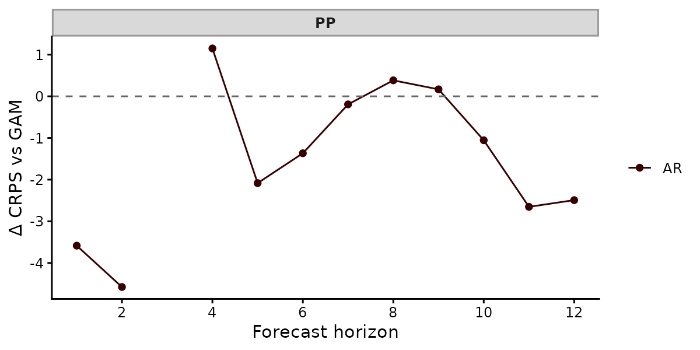

The latent state improves the forecasts. The AR model has the lower CRPS
in 8 of the 11 scored months. Its CRPS sums to 45 against 61.3 for the
smooth-only model. Its 90% intervals contain 11 of the 11 held-out
counts. Those of the model without a latent state contain 4.

[`score()`](https://nicholasjclark.github.io/mvgam/dev/reference/score.md)
also returns the log score, interval scores and, for several series,
energy and variogram scores.
[`lfo_cv()`](https://nicholasjclark.github.io/mvgam/dev/reference/lfo_cv.mvgam.md)
repeats the comparison over many forecast origins by refitting on
successively longer windows.

### Four species

The four species share the covariates but respond to them differently.
The observation formula gives each species its own mean through
`series`. In `trend_formula`, `by = lv_axis()` gives each species its
own smooths of temperature and vegetation. `AR(cor = TRUE)` gives each
species its own latent AR(1) state, with innovations correlated across
species:

``` r

fit_cor <- mvgam(
  captures ~ series,
  trend_formula = ~ s(mintemp, by = lv_axis(), k = 6) +
    s(ndvi_ma12, by = lv_axis(), k = 6) + AR(cor = TRUE),
  family        = poisson(),
  data          = train,
  newdata       = test,
  silent        = 2
)
```

[`conditional_effects()`](https://paulbuerkner.com/brms/reference/conditional_effects.brmsfit.html)
with `series = "all"` draws each species’ response to temperature in a
panel of its own. The responses differ clearly among species. Captures
of PP rise with minimum temperature and those of PB rise at the warmest
temperatures, while captures of the two kangaroo rats, DM and DO, fall
slightly:

``` r

plot(
  conditional_effects(fit_cor, effects = "mintemp", series = "all",
                      type = "expected"),
  ask = FALSE
)
```

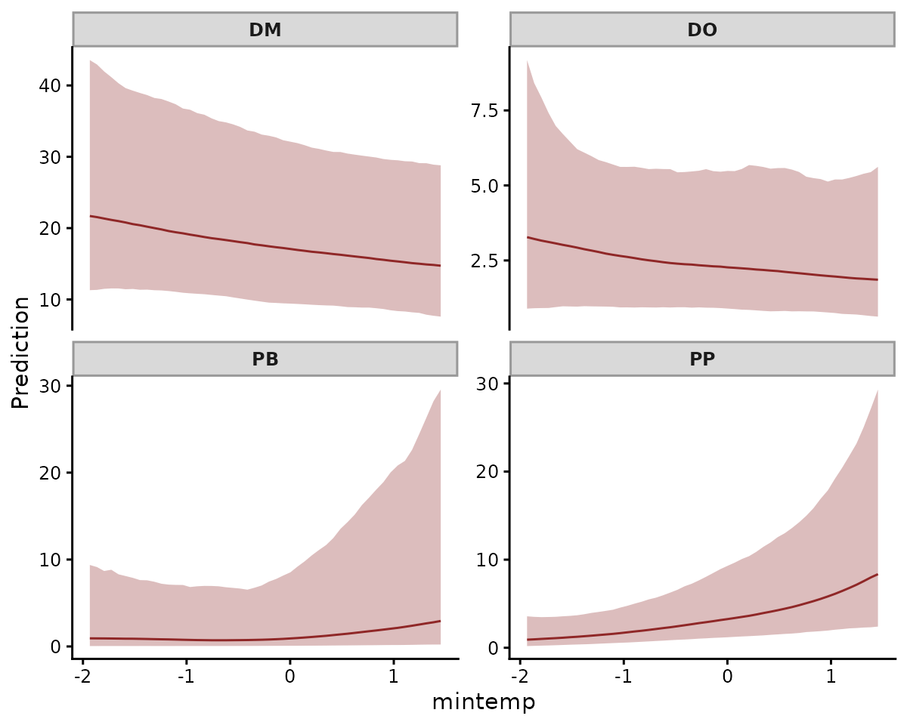

The forecasts come from one joint posterior. Each species keeps its own
scale and persistence:

``` r

fc_cor <- forecast(fit_cor)
plot(fc_cor)
```

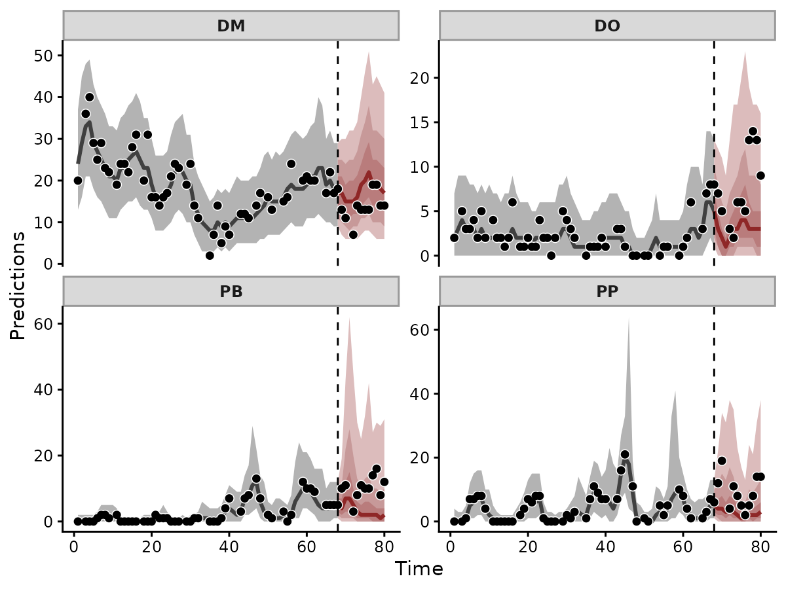

The forecasts track the held-out counts of all four species. Their 90%
intervals contain 42 of the 44 held-out counts.

[`residual_cor()`](https://nicholasjclark.github.io/mvgam/dev/reference/residual_cor.md)
returns the correlations among the species’ innovations, which measure
how strongly the species rise and fall together once temperature and
vegetation are accounted for:

``` r

rc <- residual_cor(fit_cor)
plot(rc)
```

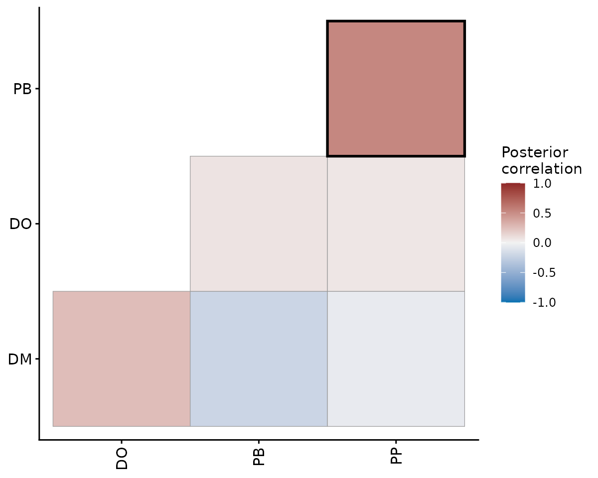

The two pocket mouse species, PB and PP, share the strongest
correlation, 0.53 (95% interval 0.09 to 0.84). `n_lv` would instead
estimate a few shared latent factors for many species.
[`VAR()`](https://nicholasjclark.github.io/mvgam/dev/reference/trend_constructors.md)
would estimate how each species’ state affects the others at the next
time step.

### Reporting

[`methods_md()`](https://nicholasjclark.github.io/mvgam/dev/reference/methods_md.md)
writes the fitted model as Markdown equations with its priors.
[`how_to_cite()`](https://nicholasjclark.github.io/mvgam/dev/reference/how_to_cite.mvgam.md)
returns a methods paragraph and the references for the model’s
components:

``` r

methods_md(fit_ar, heading_level = 4)
```

#### Data

$`\mathrm{captures}`$: non-negative integer counts

$`N = 68`$ observations, $`S = 1`$ series, $`T = 68`$ time points

Predictors:

- $`\mathrm{ndvi\_ma12}`$: continuous covariate
- $`\mathrm{mintemp}`$: continuous covariate

#### Model

``` math
\begin{aligned}
t &\in \{1, \ldots, 68\} \\
\mathrm{captures}_{i,t} &\sim \text{Poisson}(\mu_{i,t}) \\
\log \mu_{i,t} &= \alpha + \mu^{(\eta)}_{i,t} + \eta_{i,t} \\
\mu^{(\eta)}_{i,t} &= f^{(\eta)}_{\mathrm{mintemp}}(\mathrm{mintemp}_{i,t}) + f^{(\eta)}_{\mathrm{ndvi\_ma12}}(\mathrm{ndvi\_ma12}_{i,t}) \\
f^{(\eta)}_{\mathrm{mintemp}}(\mathrm{mintemp}) &= \sum_{m=1}^{K_{\mathrm{mintemp}}} \beta^{(\mathrm{mintemp}, \eta)}_m B_m(\mathrm{mintemp}) \\
f^{(\eta)}_{\mathrm{ndvi\_ma12}}(\mathrm{ndvi\_ma12}) &= \sum_{m=1}^{K_{\mathrm{ndvi\_ma12}}} \beta^{(\mathrm{ndvi\_ma12}, \eta)}_m B_m(\mathrm{ndvi\_ma12}) \\
\eta_{i,t} &= \phi_{1} \eta_{i,t-1} + \epsilon^{(\eta)}_{i,t} \\
\epsilon^{(\eta)}_{i,t} &\sim \text{Normal}(0, \sigma_\eta)
\end{aligned}
```

where:

- $`i`$ indexes series, $`t`$ indexes time
- $`\mu_{i,t}`$: conditional mean of $`\mathrm{captures}_{i,t}`$
- $`\alpha`$: population intercept
- $`\eta_{i,t}`$: latent state at series $`i`$ time $`t`$
- $`\mu^{(\eta)}_{i,t}`$: trend predictor from ‘trend_formula’
- $`f^{(\eta)}_{\mathrm{mintemp}}`$: thin plate regression spline in
  $`\mathrm{mintemp}`$, basis size $`K_{\mathrm{mintemp}} = 6`$,
  smoothing SD $`\sigma^{(s, \eta)}_{\mathrm{mintemp}}`$
- $`f^{(\eta)}_{\mathrm{ndvi\_ma12}}`$: thin plate regression spline in
  $`\mathrm{ndvi\_ma12}`$, basis size $`K_{\mathrm{ndvi\_ma12}} = 6`$,
  smoothing SD $`\sigma^{(s, \eta)}_{\mathrm{ndvi\_ma12}}`$
- $`\epsilon^{(\eta)}_{i,t}`$: process innovation, SD $`\sigma_\eta`$
- $`\phi_{l}`$: autoregressive coefficient at lag $`l`$

#### Priors

``` math
\begin{aligned}
\alpha &\sim \text{StudentT}(3, 1.2, 2.5) \\
\sigma^{(s, \eta)}_{\mathrm{mintemp}} &\sim \text{StudentT}(3, 0, 2.5) \\
\sigma^{(s, \eta)}_{\mathrm{ndvi\_ma12}} &\sim \text{StudentT}(3, 0, 2.5) \\
\sigma_\eta &\sim \text{Exponential}(2) \\
\phi_{1} &\sim \text{Normal}(0, 0.5)
\end{aligned}
```

Every other parameter takes an improper flat prior on its support.

#### Implementation

Fitted with mvgam 2.0.0 (brms 2.23.2; Stan 2.40.0 via cmdstanr).
Hamiltonian Monte Carlo: 4 chains, 1000 warmup + 1000 sampling
iterations per chain.

    mvgam(
      formula       = captures ~ 1,
      trend_formula = ~s(mintemp, k = 6) + s(ndvi_ma12, k = 6) + AR(),
      data          = pp_train,
      family        = poisson(),
      backend       = "cmdstanr",
      chains        = 4,
      iter          = 2000,
      warmup        = 1000
    )

``` r

how_to_cite(fit_ar)
#> Methods text skeleton
#> We used the R package mvgam (version 2.0.0; Clark & Wells, 2023) to
#>   construct, fit and interrogate the model. mvgam fits Bayesian
#>   state-space models that combine flexible predictor effects in both the
#>   process and observation components, using functionality from the brms
#>   (Burkner 2017) and mgcv (Wood 2017) packages. Observations followed the
#>   poisson family with a log link. The latent process followed AR(1)
#>   dynamics. The mvgam-constructed model and data were passed to Stan
#>   (Carpenter et al. 2017) via the cmdstanr interface (Gabry et al. 2024).
#>   We ran 4 Hamiltonian Monte Carlo chains for 1000 warmup iterations and
#>   1000 sampling iterations. Rank-normalised split Rhat and effective
#>   sample sizes (Vehtari et al. 2021) were used to monitor convergence.
#> 
#> Primary references
#> Burkner PC (2017). brms: An R Package for Bayesian Multilevel Models
#>   Using Stan. Journal of Statistical Software, 80(1), 1-28.
#>   https://doi.org/10.18637/jss.v080.i01
#> Carpenter B, Gelman A, Hoffman MD, Lee D, Goodrich B, Betancourt M,
#>   Brubaker M, Guo J, Li P and Riddell A (2017). Stan: A probabilistic
#>   programming language. Journal of Statistical Software, 76(1), 1-32.
#>   https://doi.org/10.18637/jss.v076.i01
#> Clark NJ and Wells K (2023). Dynamic Generalized Additive Models (DGAMs)
#>   for forecasting discrete ecological time series. Methods in Ecology and
#>   Evolution, 14(3), 771-784. https://doi.org/10.1111/2041-210X.13974
#> Gabry J, Cesnovar R, Johnson A and Bronder S (2024). cmdstanr: R
#>   Interface to 'CmdStan'. https://mc-stan.org/cmdstanr/
#> Vehtari A, Gelman A, Simpson D, Carpenter B and Burkner P (2021).
#>   Rank-normalization, folding, and localization: An improved Rhat for
#>   assessing convergence of MCMC. Bayesian Analysis, 16(2), 667-718.
#>   https://doi.org/10.1214/20-BA1221
#> Wood SN (2017). Generalized Additive Models: An Introduction with R (2nd
#>   edition). Chapman and Hall/CRC.
#> 
#> Other useful references
#> Arel-Bundock V, Greifer N and Heiss A (2024). How to interpret
#>   statistical models using marginaleffects for R and Python. Journal of
#>   Statistical Software, 111(9), 1-32.
#>   https://doi.org/10.18637/jss.v111.i09
#> Burkner PC, Gabry J and Vehtari A (2020). Approximate leave-future-out
#>   cross-validation for Bayesian time series models. Journal of Statistical
#>   Computation and Simulation, 90(14), 2499-2523.
#>   https://doi.org/10.1080/00949655.2020.1783262
#> Gabry J, Simpson D, Vehtari A, Betancourt M and Gelman A (2019).
#>   Visualization in Bayesian workflow. Journal of the Royal Statistical
#>   Society: Series A (Statistics in Society), 182(2), 389-402.
#>   https://doi.org/10.1111/rssa.12378
#> Vehtari A, Gelman A and Gabry J (2017). Practical Bayesian model
#>   evaluation using leave-one-out cross-validation and WAIC. Statistics and
#>   Computing, 27(5), 1413-1432. https://doi.org/10.1007/s11222-016-9696-4
#> 
#> Use `bibtex(x)` for a BibTeX block ready for your .bib file.
```

## Where to go next

- The [data formatting
  vignette](https://nicholasjclark.github.io/mvgam/articles/data.html)
  prepares data for
  [`mvgam()`](https://nicholasjclark.github.io/mvgam/dev/reference/mvgam.md),
  including missing values and irregular times.
- The [dynamic factor
  vignette](https://nicholasjclark.github.io/mvgam/articles/dfm.html)
  shares latent states across many series.
- The [VAR
  article](https://nicholasjclark.github.io/mvgam/articles/var.html)
  estimates how series drive one another, with impulse responses and
  variance decompositions.
- The [JSDM
  article](https://nicholasjclark.github.io/mvgam/articles/jsdgam.html)
  fits multispecies data with
  [`jsdgam()`](https://nicholasjclark.github.io/mvgam/dev/reference/jsdgam.md).
- The [N-mixture
  article](https://nicholasjclark.github.io/mvgam/articles/nmix.html)
  covers detection-error families.
- The [forecast evaluation
  article](https://nicholasjclark.github.io/mvgam/articles/forecast_evaluation.html)
  compares models with
  [`score()`](https://nicholasjclark.github.io/mvgam/dev/reference/score.md)
  and
  [`lfo_cv()`](https://nicholasjclark.github.io/mvgam/dev/reference/lfo_cv.mvgam.md)
  and combines them with
  [`ensemble()`](https://nicholasjclark.github.io/mvgam/dev/reference/ensemble.mvgam_forecast.md).

## References

Bürkner, P.-C. (2017). brms: An R package for Bayesian multilevel models
using Stan. *Journal of Statistical Software* 80(1), 1-28.
[doi:10.18637/jss.v080.i01](https://doi.org/10.18637/jss.v080.i01)

Clark, N. J. and Wells, K. (2023). Dynamic Generalized Additive Models
(DGAMs) for forecasting discrete ecological time series. *Methods in
Ecology and Evolution* 14, 771-784.
[doi:10.1111/2041-210X.13974](https://doi.org/10.1111/2041-210X.13974)

Ernest, S. K. M. et al. (2018). The Portal Project: a long-term study of
a Chihuahuan desert ecosystem. *bioRxiv* 332783.
[doi:10.1101/332783](https://doi.org/10.1101/332783)

Wood, S. N. (2017). *Generalized Additive Models: An Introduction with
R* (2nd edition). Chapman and Hall/CRC.
[doi:10.1201/9781315370279](https://doi.org/10.1201/9781315370279)
