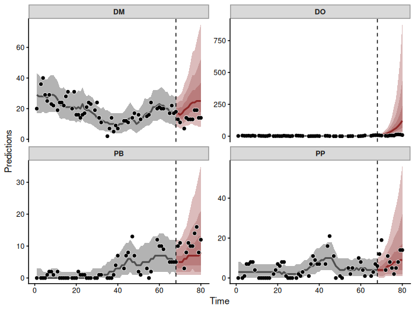
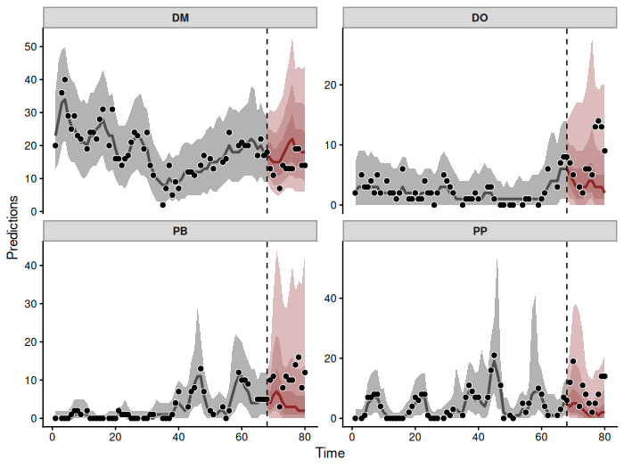
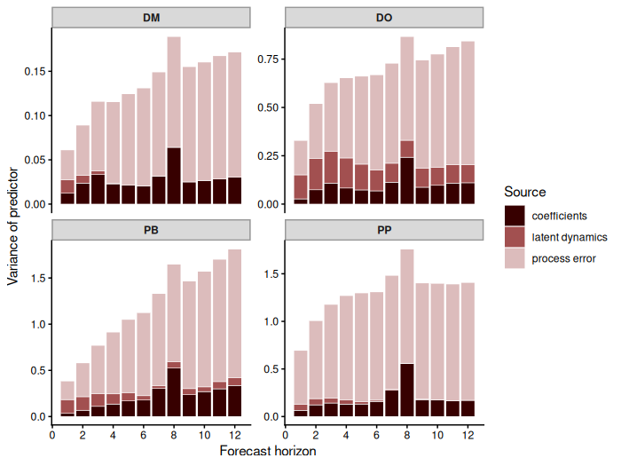
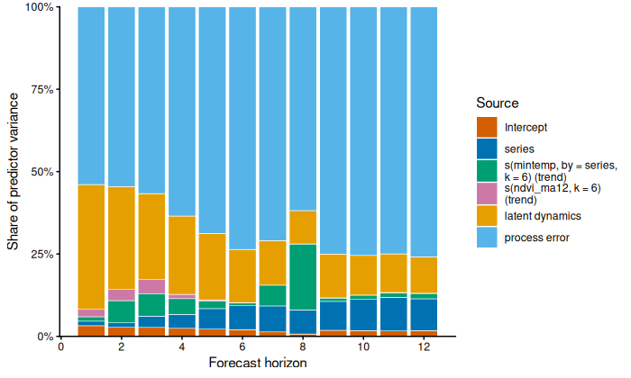
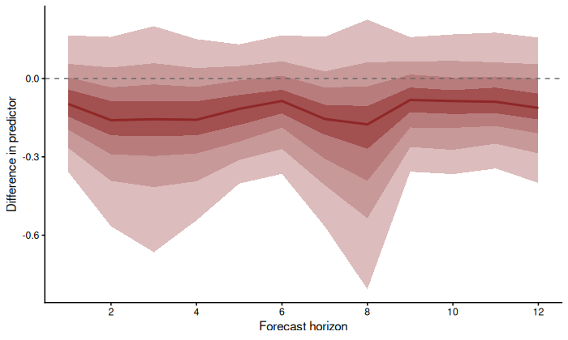
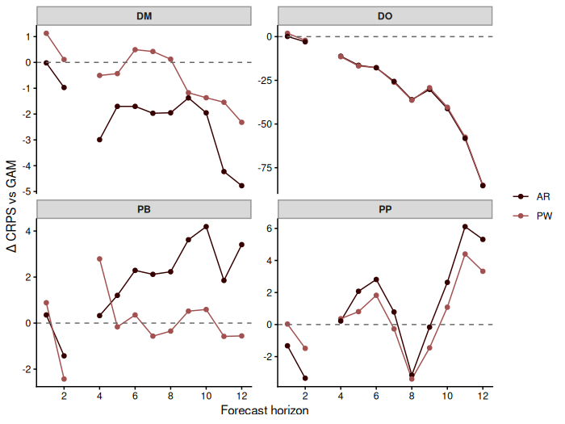
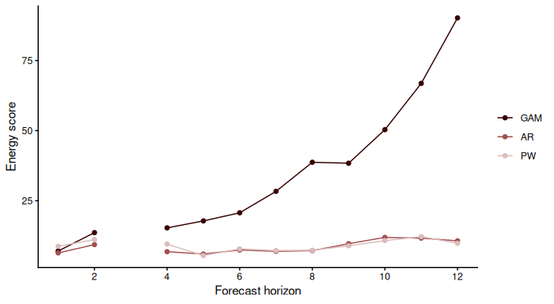
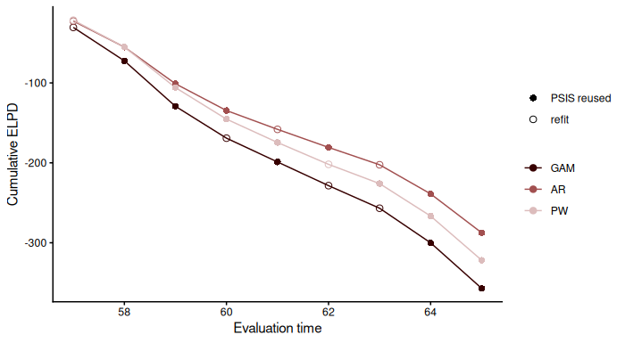

A model that describes its training data well can still forecast
poorly. To find the model that forecasts best, mvgam scores each
candidate's predictive distribution against observations the model did
not see. Every scoring rule used here is proper, in the sense that the
true predictive distribution minimises its expected value (Gneiting and
Raftery [2007](https://doi.org/10.1198/016214506000001437)). Lower
scores are better.

This article compares three models of monthly rodent captures, each
with a different trend. We score their forecasts of a twelve-month
holdout, ask where the forecast uncertainty comes from, repeat the
comparison over rolling forecast origins and combine the models into a
weighted ensemble.

## The data

`portal_data` holds captures of four desert rodents at the Portal
Project site in southeastern Arizona, summed over the control plots in
each lunar month
([Portal Project methods](https://github.com/weecology/PortalData/blob/main/SiteandMethods/Methods.md)).
The series are *Dipodomys merriami* (DM), *Dipodomys ordii* (DO),
*Chaetodipus baileyi* (PB) and *Chaetodipus penicillatus* (PP). Two
covariates accompany them: the monthly mean of minimum temperature
(`mintemp`) and a 12-month moving average of NDVI (`ndvi_ma12`). We
hold out the last 12 of the 80 months:


``` r
data(portal_data)
train <- subset(portal_data, time <= 68)
test <- subset(portal_data, time > 68)
```

## Three models

To isolate how the trend shapes a forecast, the three models share a
Poisson observation model, the two covariates and the sampler settings.
Each fit receives the holdout as `newdata`, from which `forecast()`
later takes its forecast times:


``` r
fit_portal <- function(formula, trend_formula = NULL) {
  mvgam(formula, trend_formula = trend_formula, family = poisson(),
        data = train, newdata = test, chains = 4, seed = 2026,
        silent = 2)
}
```

The first model is a generalised additive model with a smooth of time
for each species. Its forecast extends those smooths past the last
training month:


``` r
mod_gam <- fit_portal(
  captures ~ series + s(mintemp, k = 6) + s(ndvi_ma12, k = 6) +
    s(time, by = series, k = 8)
)
```

The second model gives each species a latent AR(1) state. Its
covariates move into `trend_formula`, where `by = lv_axis()` gives each
species its own smooth of temperature. `AR(cor = TRUE)` correlates the
innovations of the four states:


``` r
mod_ar <- fit_portal(
  captures ~ series,
  trend_formula = ~ s(mintemp, by = lv_axis(), k = 6) +
    s(ndvi_ma12, k = 6) + AR(cor = TRUE)
)
```

The third model replaces the AR(1) state with a piecewise linear trend.
Up to six changepoints per species fall in the first 80% of the
training months. As in Prophet (Taylor and Letham
[2018](https://doi.org/10.1080/00031305.2017.1380080)), the forecast
extends the final segment and adds new changepoints at the rate seen in
training:


``` r
mod_pw <- fit_portal(
  captures ~ series,
  trend_formula = ~ s(mintemp, by = lv_axis(), k = 6) +
    s(ndvi_ma12, k = 6) + PW(n_changepoints = 6)
)
```

## Forecasts

`forecast()` returns the predictive distribution of the captures in
each held-out month. Its `plot()` method draws the forecast after the
hindcast of the training months:


``` r
set.seed(2026)
fc_gam <- forecast(mod_gam)
fc_ar <- forecast(mod_ar)
fc_pw <- forecast(mod_pw)
```


``` r
plot(fc_gam)
```

<div class="figure" style="text-align: center">

<p class="caption">GAM hindcasts and forecasts of each species' captures, with 50%, 80% and 95% credible intervals on the forecast. Points are the observed captures. The dashed line marks the end of the training data.</p>
</div>


Each smooth of time extrapolates the slope at the end of its series.
For DO, whose captures rose over the final training months, the median
forecast reaches 121 captures by month 12. The held-out
months recorded at most 14. The AR forecast carries its
latent state forward instead:


``` r
plot(fc_ar)
```

<div class="figure" style="text-align: center">

<p class="caption">AR hindcasts and forecasts of each species' captures.</p>
</div>

## Where the uncertainty comes from

The width of a forecast does not say what causes it. To find what limits
the AR model's forecasts, `forecast_uncertainty()` splits the variance
of the forecast at each horizon by source. Each posterior draw is
propagated many times, which separates what the posterior leaves
unknown from what the future adds. The split uses the link scale, where
the parts of the model add:


``` r
set.seed(2026)
unc_ar <- forecast_uncertainty(mod_ar, ndraws = 500)
unc_ar
#> Forecast uncertainty by source, predictor, 500 draws, 20 replicates
#> 
#>  series sd_first sd_last dominant      support changes_at
#>  DM     0.25     0.41    process error 1                 
#>  DO     0.57     0.92    process error 1                 
#>  PB     0.62     1.30    process error 1                 
#>  PP     0.83     1.20    process error 1                 
#> 
#> summary() gives every source at every horizon.
plot(unc_ar)
```

<div class="figure" style="text-align: center">

<p class="caption">Variance of the AR model's forecast predictor at each horizon, split by kind of source.</p>
</div>


Process error, the variance the state's innovations add, leads for every
species by month 12. Because this variance belongs to the process, more
data will not shrink it. For DO it grows from
54% of the variance at month 1 to
76% at month 12. Because an AR(1) state
loses its memory of the last training month, the latent dynamics fade
from 38% to
11% over the same months.

The bars jump at month 8. With `by = "source"` and `type = "share"`, the
plot names the term responsible:


``` r
plot(unc_ar, type = "share", by = "source", series = "DO")
```

<div class="figure" style="text-align: center">

<p class="caption">Share of the variance of the DO forecast held by each term.</p>
</div>

The temperature smooth peaks at month 8. Minimum temperature that month
was -2.1, below the coldest training month at
-1.93. The smooth extrapolates
there, which widens the forecast.

A forecast also depends on the future of its covariates.
`forecast_uncertainty()` takes a named list of possible futures.
Because every future takes the same draws and the same innovations,
their difference isolates what the covariates change:


``` r
warmer <- test
warmer$mintemp <- warmer$mintemp + 1
sc <- forecast_uncertainty(mod_ar, newdata = list(observed = test,
                                                  warmer = warmer),
                           ndraws = 500)
plot(sc, series = "DO")
```

<div class="figure" style="text-align: center">

<p class="caption">Difference in the DO forecast's predictor between a future one standard deviation warmer and the observed one, with nested 20%, 40%, 60% and 80% credible intervals.</p>
</div>


The median difference at month 12 is -0.11, with a 95%
interval from -0.53 to 0.33. The largest
median difference, -0.18, falls at month
8.

## Scoring the holdout

`compare_scores()` scores several forecasts with one rule and returns
one row per model, series and horizon. The continuous ranked
probability score (CRPS) generalises the absolute error to a predictive
distribution. With `relative`, `plot()` draws each model's score minus
that of a baseline:


``` r
crps <- compare_scores(fc_gam, fc_ar, fc_pw, score = "crps",
                       model_names = c("GAM", "AR", "PW"))
plot(crps, relative = "GAM")
```

<div class="figure" style="text-align: center">

<p class="caption">CRPS of the AR and PW forecasts minus that of the GAM at each horizon. Negative values favour the AR or PW model. No species was observed at horizon 3.</p>
</div>


Between AR and the GAM, the lower mean CRPS goes to AR on
DM, AR on DO, the GAM on PB and the GAM on PP.
On DO the mean CRPS is 3.25 for AR and
32.77 for the GAM. PB and PP recorded few or no
captures over long stretches. Averaged over the species, AR scores
3.95 against 3.86 for PW.

The energy score grades the four forecasts at each horizon as one
multivariate distribution (Gneiting et al.
[2008](https://doi.org/10.1007/s11749-008-0114-x)). `compare_scores()`
holds a joint score in the rows whose series is `all_series`:


``` r
energy <- compare_scores(fc_gam, fc_ar, fc_pw, score = "energy",
                         model_names = c("GAM", "AR", "PW"))
plot(energy)
```

<div class="figure" style="text-align: center">

<p class="caption">Energy score of the joint forecast of the four species at each horizon.</p>
</div>


The GAM's energy score runs from 7 to 90 over the
twelve months. AR and PW stay below 13. `score()` offers nine more
rules, among them the variogram score for the dependence between series
and threshold-weighted scores for a range of the response.

## Rolling forecast origins

The holdout scores one twelve-month forecast from one origin. To test
whether the ranking holds across origins, `lfo_cv()` runs approximate
leave-future-out cross-validation (Bürkner et al.
[2020](https://doi.org/10.1080/00949655.2020.1783262)). Starting from
the first `min_t` months, it forecasts the `fc_horizon` months that
follow each origin in turn. It scores each forecast by its expected log
predictive density (ELPD). Pareto-smoothed importance sampling
reweights the existing fit to each new origin. The model is refit only
where the Pareto $k$ diagnostic crosses its threshold. Leave-one-out
cross-validation with `loo()` suits these models poorly. A latent state
that the neighbouring months still inform predicts each left-out month,
which turns the comparison into one of interpolation.

`save_log_lik = TRUE` keeps the pointwise log densities that the
stacking weights below require:


``` r
run_lfo <- function(mod) {
  lfo_cv(mod, min_t = 56, fc_horizon = 4, save_log_lik = TRUE,
         silent = 2)
}
lfo_gam <- run_lfo(mod_gam)
lfo_ar <- run_lfo(mod_ar)
lfo_pw <- run_lfo(mod_pw)
loo_compare(lfo_gam, lfo_ar, lfo_pw, model_names = c("GAM", "AR", "PW"))
#>  model elpd_diff se_diff p_worse diag_diff diag_elpd
#>     AR       0.0     0.0      NA                    
#>     PW     -34.3     7.7    1.00   N < 100          
#>    GAM     -69.5     4.7    1.00   N < 100
```


AR leads. PW trails it by 34 (SE 8) and
GAM by 70 (SE 5). The log score penalises an
observation in the tail of a forecast far more heavily than the CRPS
does. `compare_elpds()` tabulates the ELPD at each origin:


``` r
elpds <- compare_elpds(lfo_gam, lfo_ar, lfo_pw,
                       model_names = c("GAM", "AR", "PW"))
plot(elpds, cumulative = TRUE)
```

<div class="figure" style="text-align: center">

<p class="caption">Cumulative ELPD over the forecast origins. Open circles mark the origins at which the model was refit.</p>
</div>

## A weighted ensemble

Stacking chooses the weights that maximise the log score of the
mixture of the models' predictive distributions (Yao et al.
[2018](https://doi.org/10.1214/17-BA1091)). `loo_model_weights()`
computes them from the leave-future-out densities. `ensemble()`
combines the forecasts in those proportions. `compare_scores()` then
scores the ensemble with its components:


``` r
weights <- loo_model_weights(lfo_gam, lfo_ar, lfo_pw, method = "stacking",
                             model_names = c("GAM", "AR", "PW"))
weights
#> Method: stacking
#> ------
#>     weight
#> GAM 0.000 
#> AR  0.668 
#> PW  0.332
fc_ens <- ensemble(fc_gam, fc_ar, fc_pw, weights = weights,
                   seed = 2026)
crps_ens <- compare_scores(fc_gam, fc_ar, fc_pw, fc_ens, score = "crps",
                           model_names = c("GAM", "AR", "PW", "Ensemble"))
aggregate(score ~ model, FUN = mean,
          data = subset(crps_ens, series != "all_series"))
#>      model     score
#> 1      GAM 11.132286
#> 2       AR  3.945342
#> 3       PW  3.855793
#> 4 Ensemble  3.796325
```


Stacking gives 0 to the GAM, 0.67 to AR and 0.33 to PW.
The ensemble's mean CRPS on the holdout is 3.80,
the lowest of the four.

## Summary

The CRPS and the energy score compared the three forecasts on the
holdout. Under leave-future-out cross-validation AR led in
ELPD. The GAM's smooths of time extrapolated the end of each series.
Stacking combined the three forecasts into an ensemble with a mean
CRPS of 3.80. Each step took one or two function calls on the
fitted models. The CRPS and the log score can rank models differently.
Choose the scoring rule before scoring any forecast.

## Where to next

Each function used here has a help page, such as `?score` or
`?lfo_cv`, with its arguments and output. `how_to_cite()` writes a
methods paragraph for each fitted model. `methods_md()` writes out its
equations.

Related articles:

- [Vector autoregressions](var.html)
  model the lagged effects of one species on another.
- [Hierarchical vector autoregressions](hierarchical_var.html)
  pool dynamics across groups of series.
- [N-mixture models](nmix.html)
  forecast abundance from counts with imperfect detection.

## References

Bürkner P-C, Gabry J and Vehtari A (2020). Approximate
leave-future-out cross-validation for Bayesian time series models.
*Journal of Statistical Computation and Simulation* 90(14), 2499-2523.
[doi:10.1080/00949655.2020.1783262](https://doi.org/10.1080/00949655.2020.1783262)

Gneiting T and Raftery AE (2007). Strictly proper scoring rules,
prediction, and estimation. *Journal of the American Statistical
Association* 102(477), 359-378.
[doi:10.1198/016214506000001437](https://doi.org/10.1198/016214506000001437)

Gneiting T, Stanberry LI, Grimit EP, Held L and Johnson NA (2008).
Assessing probabilistic forecasts of multivariate quantities, with an
application to ensemble predictions of surface winds. *TEST* 17(2),
211-235.
[doi:10.1007/s11749-008-0114-x](https://doi.org/10.1007/s11749-008-0114-x)

Taylor SJ and Letham B (2018). Forecasting at scale. *The American
Statistician* 72(1), 37-45.
[doi:10.1080/00031305.2017.1380080](https://doi.org/10.1080/00031305.2017.1380080)

Yao Y, Vehtari A, Simpson D and Gelman A (2018). Using stacking to
average Bayesian predictive distributions. *Bayesian Analysis* 13(3),
917-1003.
[doi:10.1214/17-BA1091](https://doi.org/10.1214/17-BA1091)
